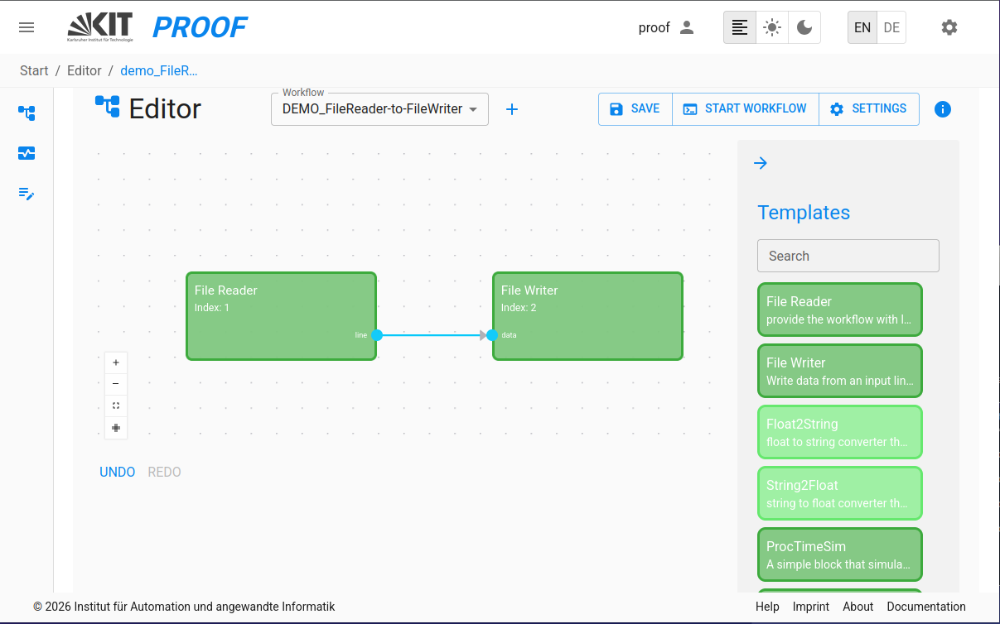
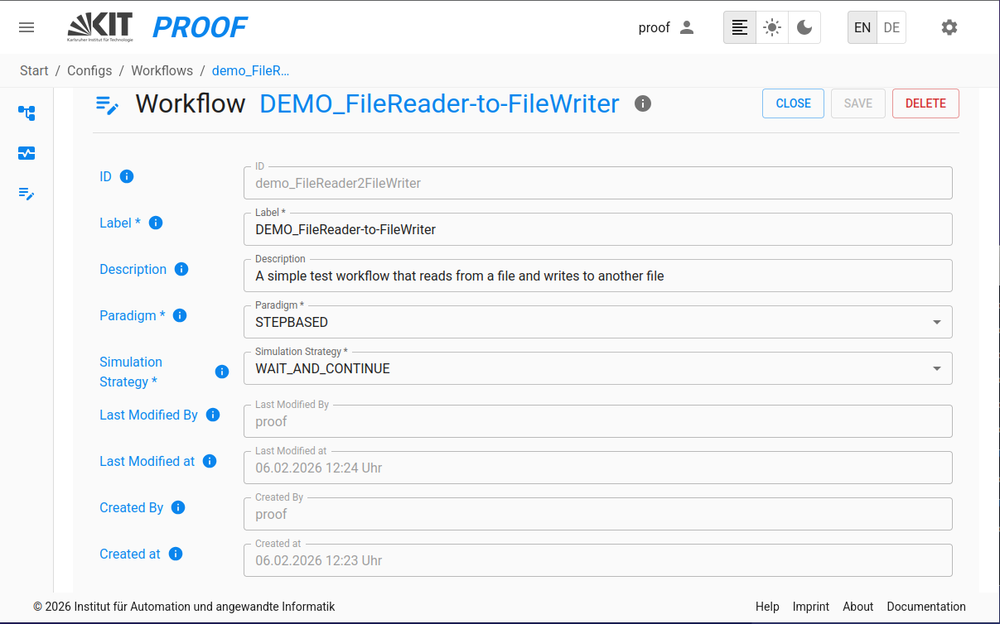
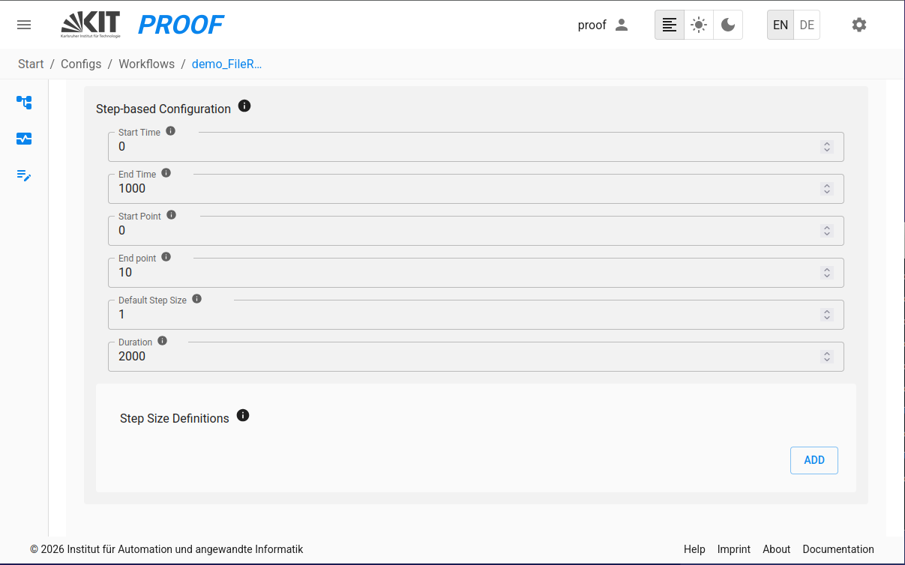
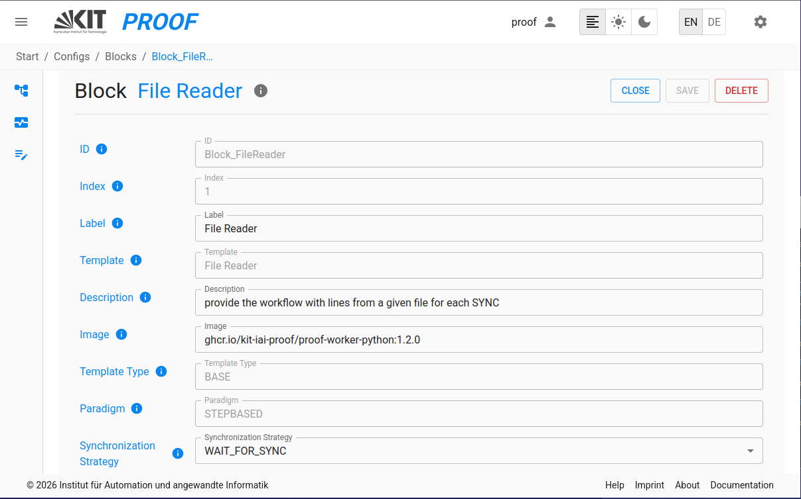
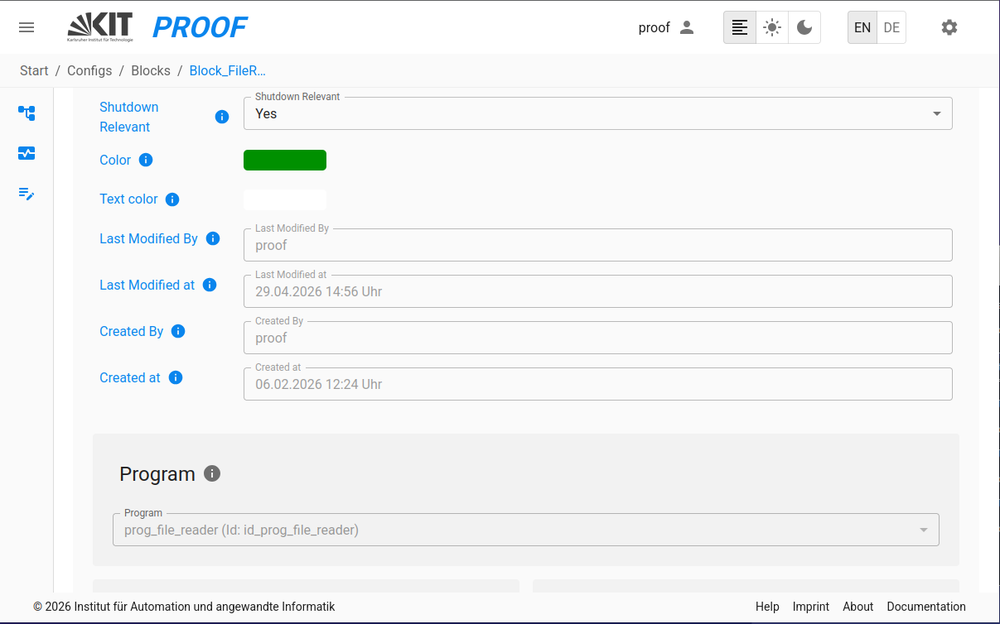
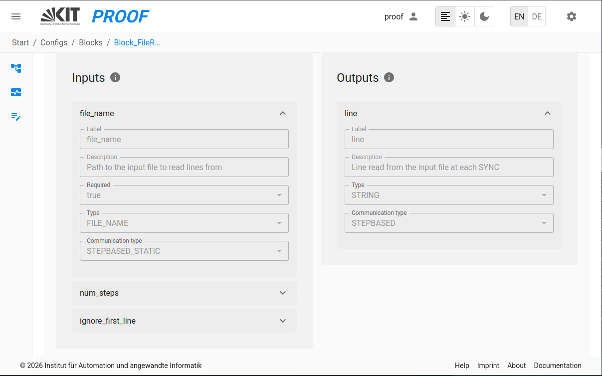
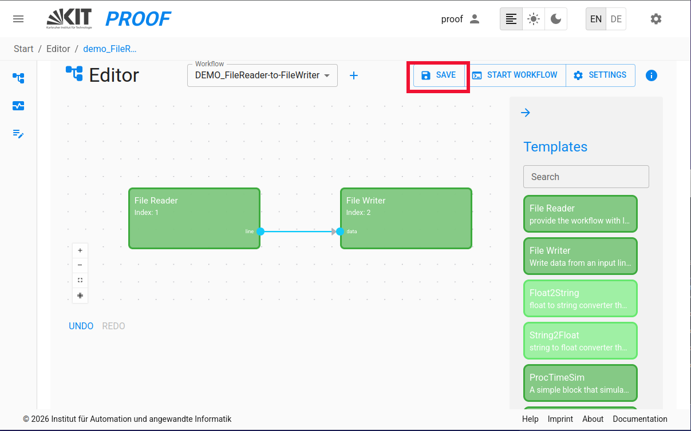
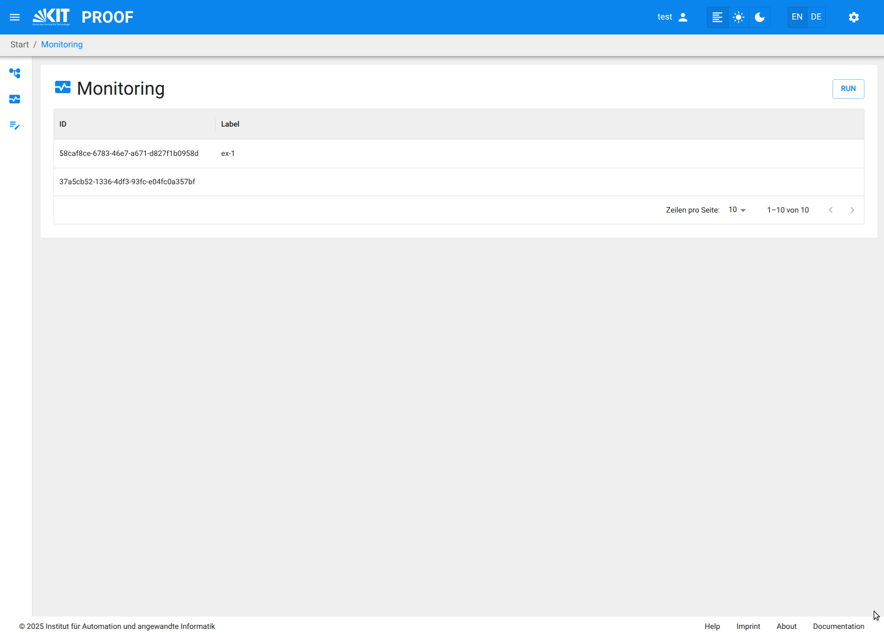

# Create a Workflow in PROOF UI

On the proof UI, you can create new PROOF *Workflows* by selecting the *Workflow Editor* from the menu.
The *Workflow Editor* is the main interface for creating and managing *Workflows* in PROOF.
It provides a visual representation of the Workflow structure, allowing users to drag and drop Blocks, connect them, and configure their settings.
 

## Add a new Workflow
   - You can create a new Workflow by clicking on the "*+*" button in the Workflow Editor to the right of the Workflow combo box.
   - This opens the [Workflow Settings window](#configure-workflow-settings) of the created Workflow. Customize the label, description and parametrization of the Workflow here.
   - Closing the settings window leads to the empty Workflow canvas where you can start building your Workflow.
   
## Add PROOF *Blocks* to the *Workflow* from *Block Templates*
   - You can drag and drop *Block Templates* from the right sidebar onto the Workflow canvas.
   - Each Block Template represents a predefined specific functionality or model that can be used in the Workflow.
   - A *Block* is created as an instance of the *Block Template* when it is added to the Workflow.
   - The connectable inputs and outputs of each Block are represented by small circles on the left and right sides of the Block, respectively.
   
## Connect Blocks
   - You can connect Blocks by clicking on the output of one Block and dragging it to the input of another Block.
   - This establishes a data flow between the Blocks, allowing them to communicate and share data.
   - When trying to connect Blocks, only compatible input and output pins are connectable. Compatible pins have the same color and data type.
    

### Loop Connections
   - A loop in a workflow is a scenario where the output of a block A is used as input for another block B which then again connects to block A.
   - In general, a loop can span over an arbitrary number of blocks as long as the output of a block A, processed by n blocks, is used as an input of block A again.
   - Loops can be implemented by using a static input (INIT phase) as initial value for the non-static input in EXECUTION phase.
     - Both inputs need to use the same *modelVarName*.

## Configure *Workflow* Settings
   - You can configure the settings of the Workflow by clicking on the "Settings" button in the top right corner of the Workflow Editor.
   - This allows you to set ID, label, description, paradigm, and asynchronous Action for the entire Workflow.
   - By clicking on the "save" button, the Workflow settings are saved.
     
     

## Workflow Timeouts

Step-based *Workflows* provide two configurable timeouts that control the behaviour of an execution
when the process does not proceed as expected. Both values are interpreted in **seconds** and are
part of the *Workflow's* *Step-Based Configuration* (`stepBasedConfig`).

### Worker Timeout (`workerTimeout`)

The *Worker Timeout* defines how long the orchestrator waits for notify messages from **all** workers
(*Blocks*) of the *Workflow*. The waiting time accumulates over consecutive scheduling cycles. As soon
as it exceeds the configured *Worker Timeout*, the orchestrator finalizes all blocks and shuts down the
*Workflow*.

- **Default**: `10` seconds
- Increase this value for *Blocks* with long execution times per step (e.g., complex FMU model
  computations) so that a slow but healthy *Block* does not cause a premature shutdown.
- Decrease this value to fail fast when a *Workflow* is expected to respond quickly.

### Input Timeout (`inputTimeout`)

The *Input Timeout* defines how long a worker waits at most for a required input value during a step.
If the timeout is exceeded, the worker tries to use the `defaultValue` of the corresponding input if
one is defined. If no default value is available, the step returns with a timeout (error) for
this *Block*.

- **Default**: `10` seconds
- Values below `0.5` seconds are clamped to `0.5` seconds.
- The value is propagated to each block container

### Setting the Timeouts

The timeouts can be set in two places:

- **Workflow Configuration**: In the *Configs Tab*, edit the *Workflow* and set *Worker Timeout* and
  *Input Timeout* in the *Step-Based Configuration* panel. These values are stored with the *Workflow*
  and used for every execution.
- **Execution Start Parameters**: In the *Monitoring* view, both timeouts can be overridden per
  execution in the start parameters before running the *Workflow*. The entered values are used for
  this execution only and do not change the stored *Workflow* configuration.

**Note**: For PROOF installations, deployment-level defaults for both timeouts can also be configured
via the environment settings `proof.orchestration.worker.timeout` (orchestrator) and
`proof.worker.input.timeout` (worker). The *Workflow*-specific values take precedence.

## Configure *Block* Settings
   - You can configure the Name of each Block by right-clicking on it, selecting "Settings" and accessing the Block configuration panel.
   - It is not possible to change the basic functionality of a Block, as it is defined by the Block Template. 
     - Some parameters which are inherited from the Block Template can be changed (e.g. the container *Image*). If they differ from the Block Template they are being marked visually.
     - It is possible to change all Template attributes as well as the associated Program and Attachments using the Template Configuration panel.
   - **Inputs are displayed alphabetically** in the Block configuration for better organization and discoverability.

   
   
   

### Important: Block Naming Restrictions
When setting the block name/title, you must follow Docker container naming conventions:

- **Do not use brackets `()` or other special characters** such as `!`, `@`, `#`, `$`, `%`, etc.
- **Spaces in block titles are automatically removed** when creating Docker container names
- Use only alphanumeric characters, hyphens `-`, and underscores `_`
- The block title is used to create the Docker container name for that block

**Examples:**

- ✅ Good: `FileReader1`, `My_Block`, `Data-Processor`
- ❌ Bad: `Reader(1)`, `My Block!`, `Data@Processor`

Violating these restrictions will cause errors when executing the workflow, as Docker cannot create containers with invalid names.

## Save the *Workflow*
   - Once you have built your Workflow, you must save it by clicking on the "Save" button in the top right corner of the Workflow Editor.
   - This saves the Workflow to the PROOF database, making it available for execution and further editing.
     

### Executing the workflow
## ... via Workflow Editor
   - After having saved the Workflow, you can execute it by navigating to the *START WORKFLOW* button in the top right corner of the Workflow editor.
   - You must enter all relevant Execution values in the pop-up execution dialog, such as Execution ID, Description, and other parameters specific to the Workflow.

## ... via Monitoring Panel
   - You can also start a saved Workflow from the *Workflow Monitoring* panel in the PROOF UI.
   - Click the *Workflow Monitoring* menu item in the left menu bar to open the monitoring interface.
   - Press the *RUN* button in the top right corner of the Workflow Monitoring interface. A Combo box appears listing all saved Workflows.
   - Select the saved Workflow from the list and click on the "Start" button to initiate the execution.
   - Enter all necessary attribute values in the pop-up execution dialog, such as Execution Label, Description, and all start values for the given Inputs.
   - Monitor the execution progress and view results through the Workflow Monitoring interface.
     
