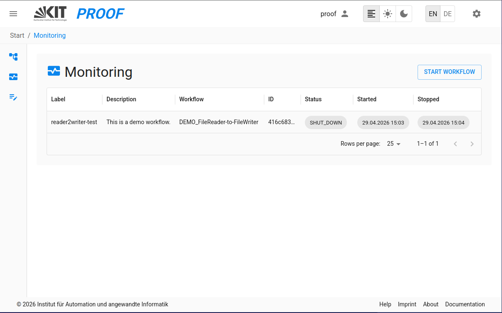
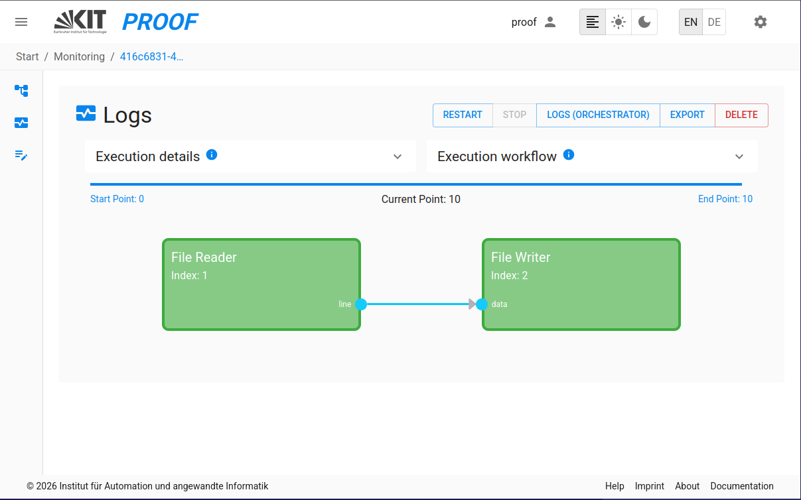
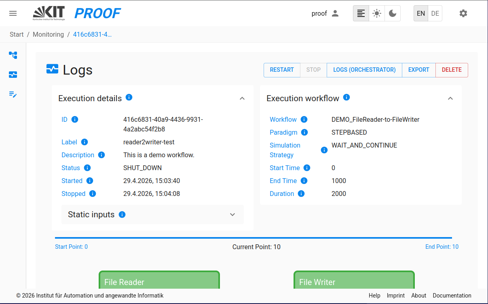

On the proof UI, you can monitor Executions by selecting the *Monitoring* from the menu.
## Execution Monitoring
The Execution Monitoring is the main interface to run, execute, and stop executions and check logs in PROOF.

### 1. **Monitoring Table**
This interface allows you to monitor the status of executions, including their execution status, logs, and other relevant information.

By clicking "START WORKFLOW" the a dropdown list with all available workflows appears. After a workflow is selected in the dropdown list, it can be executed by clicking on the "EXECUTE" button in the top right corner of the Execution Monitoring interface.

### 2. **Execution Progress Tracking**
During execution, PROOF provides real-time progress tracking:

- **Progress Visualization**: Visual progress bars showing the current state of execution
- **Communication Point (CP) Tracking**: See the current communication point being processed

#### 2.1. **Block Status Monitoring Service**
The Block Status Monitoring Service provides real-time visualization of individual block execution states:
- **Real-time Block Status Updates**: Monitor individual block states and communication points
- **Block-specific Logs**: Monitor the logs of individual blocks in real-time
- **Status Indicators**: Visual indicators showing each block's current state (INIT, EXECUTE, FINALIZE, SHUTDOWN)
- **Log Storage**: Model logs are automatically saved in `proof-environment/data/executions/` organized by execution ID as specified in the docker-compose file
#### 2.2 **Data-Flow Visualization**
During an execution, PROOF visualizes how data flows between the *Blocks* of a *Workflow*. This also allows you to inspect all ports of a *Block* independently of the connection layout.

- **Data Visualization**: Input and output values between *Blocks* can be accessed by clicking on a connection, in- or output.
  - **Connection**: See the actual data values that are sent from one *Block* to another.
  - **Output**: See the published data values for this output.
  - **Input**: See the data values received in this input.
- **Basic Data-Flow Visualization**: A basic representation of the data flow direction and activity between connected *Blocks*.
  - Highlights the active path of data exchange during execution.

#### 2.3 **Log Window Improvements**
By clicking on the respective blocks the log view for these blocks can be accessed.

#### 2.4 **Execution Settings**
The collapsable section at the top holds all information about the configuration that was used for this execution. 

- **Input Values Display**: View input values and workflow parameters for the execution
- **Execution Parameters**: Full visibility of execution start and run parameters in the monitoring view
  - Detailed execution settings display with better layout and readability
  - View all execution configuration details

### 3. **Export Executions**
- **Export Execution**: Export a complete workflow execution as a ZIP file, including all configurations, templates and attachments. This feature is available to all users.